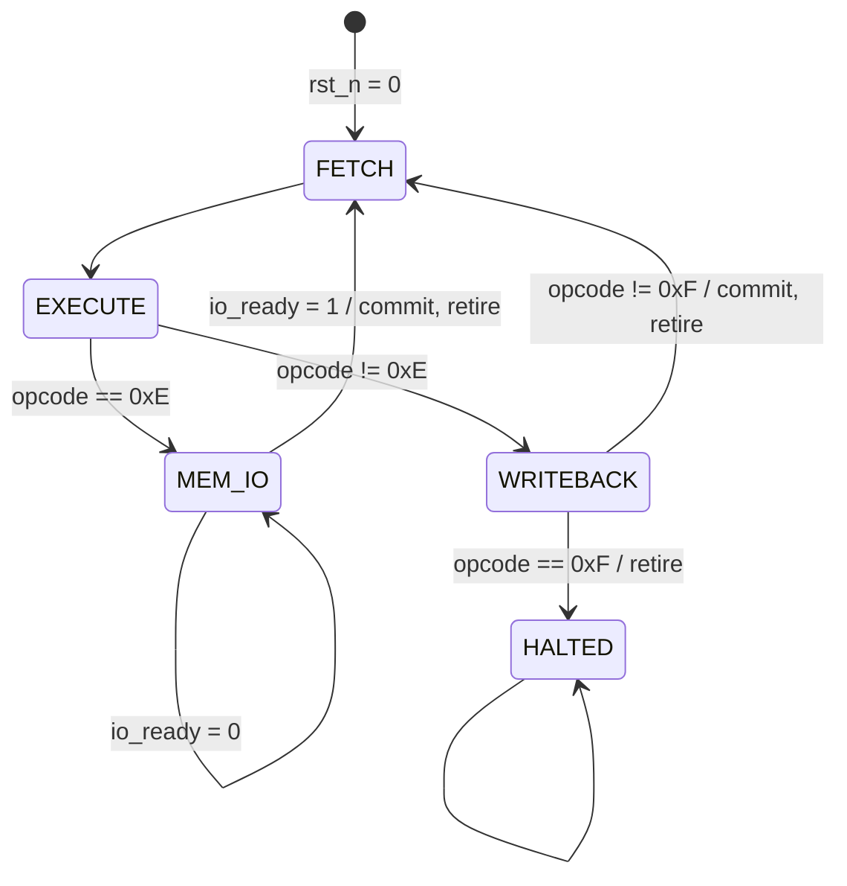

# DSD-8 Design Report

*Team: ______ · Members: A ______ (fetch/decode), B ______ (datapath), C ______ (control, memory, I/O) · Date: ______*

Spec §9.3 item 4 (6–10 pages). Companion documents: `doc/m1/microarchitecture.md`
(diagrams), `doc/m1/control_signal_table.md` (full table),
`doc/verification_report.md`, `doc/bug_log.md`.

---

## 1. Microarchitecture

**Choice: multi-cycle FSM, three cycles per instruction, plus stall cycles for I/O.**

The spec (§4.3) allows single-cycle, multi-cycle or pipelined. We chose the
recommended multi-cycle FSM because the frozen interfaces were designed for it
(the §6.2 table, the `control_unit` port list) and because it gives exactly
one instruction in flight — so program-order retirement and "one `retire`
pulse per instruction" (R13, R22) are true by construction rather than by
hazard logic.

The organising idea is the **PC-holds scheme**: the program counter keeps the
address of the executing instruction for all of its cycles and advances only
in the instruction's commit cycle. Because `instr_memory` reads
combinationally, `imem_data` is the instruction register and `pc` is
`retire_pc`. Nothing has to be copied or delayed for the trace, and the frozen
`control_unit` port list — which has no "load IR" output — is respected
without workarounds.

| State | Cycle role | Commits |
|---|---|---|
| FETCH | PC addresses IMEM; the word settles | nothing |
| EXECUTE | decoder → register-file reads → ALU, DMEM address, branch decision settle | nothing |
| WRITEBACK | commit cycle for every non-I/O instruction | rf / mem / flags / PC, `retire = 1` |
| MEM_IO | IN/OUT request held until `io_ready` | in the `io_ready` cycle only |
| HALTED | entered after HLT retires | nothing, ever |

Cycles per instruction: **3** for 15 of the 16 opcodes; **3 + n** for IN/OUT,
where *n* is the number of cycles the peripheral holds `io_ready` low (0 for
on-board ports, 1–8 for the SLOW_ECHO model). Example: T36 (multiply, 51
instructions, one OUT) takes 153 cycles; at the board's 25 MHz core clock
that is 6.1 µs.

### 1.1 State machine

`control_unit` is written in the three-process style: a clocked state
register with synchronous active-low reset, a combinational next-state block,
and a combinational output block that assigns a default to every output
before the `case`, so no latch can be inferred (Verilator `-Wall` is clean).
Outputs are Moore (state only) except for three Mealy terms: `pc_load`
depends on `flags` (branch taken), and in MEM_IO `rf_we`, `pc_en` and
`retire` depend on `io_ready`.

### 1.2 Datapath

See the annotated block diagram in `doc/m1/microarchitecture.md`. Read port 1
is always `rs1`, which feeds both the ALU's `a` input and the data-memory
address (DSD-8 has no address arithmetic). Read port 2 feeds the ALU's `b`,
the data-memory write data and `io_wdata`. The write-back mux selects ALU /
DMEM / imm8 / io_rdata as encoded by `wb_sel`.

## 2. Control-signal table, as implemented

Values in the **commit cycle**; every enable is 0 in FETCH, EXECUTE and
HALTED. (`–` = not used; the RTL drives 0 / ALU.)

| Instr | rf_we | mem_we | io_rd | io_wr | flags_we | wb_sel | pc_en | pc_load | retire | Commit state |
|---|---|---|---|---|---|---|---|---|---|---|
| NOP | 0 | 0 | 0 | 0 | 0 | – | 1 | 0 | 1 | WB |
| LDI | 1 | 0 | 0 | 0 | 0 | 2 | 1 | 0 | 1 | WB |
| LD | 1 | 0 | 0 | 0 | 0 | 1 | 1 | 0 | 1 | WB |
| ST | 0 | 1 | 0 | 0 | 0 | – | 1 | 0 | 1 | WB |
| ADD SUB AND OR XOR SHL SHR | 1 | 0 | 0 | 0 | 1 | 0 | 1 | 0 | 1 | WB |
| CMP | 0 | 0 | 0 | 0 | 1 | – | 1 | 0 | 1 | WB |
| JMP | 0 | 0 | 0 | 0 | 0 | – | 1 | 1 | 1 | WB |
| Bcc | 0 | 0 | 0 | 0 | 0 | – | 1 | taken | 1 | WB |
| IN | io_ready | 0 | 1 (held) | 0 | 0 | 3 | io_ready | 0 | io_ready | MEM_IO |
| OUT | 0 | 0 | 0 | 1 (held) | 0 | – | io_ready | 0 | io_ready | MEM_IO |
| HLT | 0 | 0 | 0 | 0 | 0 | – | **0** | 0 | 1 | WB → HALTED |

Deviation from the literal §6.2 table: none in the values at the `dsd8_cpu`
boundary. Inside, `control_unit` drives `io_rd = io_wr = 1` and
`rf_we = io_ready` for every opcode 0xE, because it cannot see `io_dir`;
`dsd8_cpu` reduces them to the IN or OUT row (decision D5).

## 3. Module-by-module notes

| Module | Owner | Notes that are not obvious from the code |
|---|---|---|
| `prog_counter` | A | `pc + 9'd1` wraps 0x1FF → 0x000 by width alone; `pc_en = 0` both holds the PC during an instruction's first two cycles and freezes it after HLT. Tested with X07 (wrap through 0x1FF). |
| `instr_memory` | A | supplied; combinational read. Words past the end of an image are X; every program ends in HLT so they are never fetched. |
| `instr_decoder` | A | nine part-selects, no `case`, never looks at the opcode. Overlaps (rd = cond, imm8 = port, rs1 ⊂ addr9) are deliberate. |
| `register_file` | B | synchronous write, combinational read, **no** write-through forwarding (R14). In our FSM this matters: during WRITEBACK the instruction's own sources are still being read; forwarding would create a combinational loop (`wd` depends on `rd1`) — mutation M17 shows the unit TB catches it. |
| `alu` | B | one 9-bit adder for ADD/SUB/CMP: `sum9 = a + b_eff + subtract`, `b_eff = subtract ? ~b : b` (R15). Overflow is computed once from `b_eff`, which reproduces both rows of the §2.3.2 table. |
| `flags_reg` | B | four flip-flops with `flags_we`; `{Z,N,C,V}` = bits 3..0 everywhere. |
| `data_memory` | C | array initialised to 0x00 in an `initial` block (decision D3). |
| `control_unit` | C | §1.1. Branch decision is an 8-way mux on `cond` over the committed flags. |
| `io_bus` | C | decodes 0x00–0x1F locally (switches, buttons, LEDs, 7-seg; unmapped → 0x00, never stall) and forwards ≥ 0x20 to the peripheral side; `io_ready` is never high without a request (R20). LEDs/7-seg registers are written at the edge that completes the OUT. |
| `dsd8_cpu` | all | the four glue functions (decisions D4, D5 and §1.2). |
| `dsd8_top` | all | board build: reset synchroniser, core clock = clk/4, button debouncer, 7-seg multiplexer (decision D7). |

## 4. Design-decision record

| # | Decision | Alternatives considered | Why this one |
|---|---|---|---|
| D1 | **Multi-cycle FSM, 3 cycles/instr** | single-cycle (1 CPI); pipelined; 5-state FETCH/DECODE/EXECUTE/MEM/WB | One instruction in flight makes R13/R22 true by construction and the trace trivially aligned. Single-cycle would need the commit and the next fetch in one edge with no place to wait for `io_ready`. Pipelining needs hazard logic and in-order retirement bookkeeping before conformance — the spec says "only after conformance". DECODE and MEM states would be empty with combinational memories, adding 2 CPI for nothing. |
| D2 | **PC holds the executing instruction; `imem_data` is the IR** | advance PC in FETCH and keep an IR + old-PC copy in `dsd8_cpu` | The frozen `control_unit` has no IR-load output; keeping the PC still means no extra registers, `retire_pc = pc`, `retire_ir = imem_data`, and the FETCH cycle leaves room for a registered (BRAM) instruction read on the FPGA without changing the FSM. |
| D3 | **DMEM zeroed by an `initial` block** | FSM writes 0x00 to all 256 addresses after reset | `data_memory` has no reset port and its address comes from `rd1`, so an FSM clear needs an extra address mux and a counter in `dsd8_cpu`, and adds 256+ cycles before the first instruction of every test. Initial values are honoured by every simulator and by FPGA RAM configuration. **Accepted limitation:** a second reset during a run does not re-clear DMEM. Every test and the board demo reset once; noted in the verification report. |
| D4 | **Retire in the commit cycle (guide Scheme A) with a flags bypass** | retire one cycle after the commit with captured copies (Scheme B) | All ten trace values are live and describe the same instruction in the commit cycle; only `retire_flags` needs a mux (`flags_we ? alu_flags : flags_out`) because `flags_reg` updates at the sampling edge. Scheme B needs ten capture registers, and a half-captured design is the classic "flags lag" bug (mutation M06 shows we would catch it). |
| D5 | **IN/OUT resolved in `dsd8_cpu` glue** | add an `io_dir` input to `control_unit`; decode bit 8 inside the CU from another input | The CU port list is frozen and carries no instruction bits other than `opcode` and `cond`. The CU therefore requests both directions for opcode 0xE and the glue keeps one: `io_rd = cu_io_rd & ~io_dir`, `io_wr = cu_io_wr & io_dir`, `rf_we = cu_rf_we & ~(op==E & io_dir)`. Three gates, one place. |
| D6 | **I/O commits in the `io_ready` cycle (Mealy)** | latch `io_rdata` at the ready edge and commit one cycle later (Moore) | No extra register, one cycle less per I/O, and the bus request drops in the cycle after the transfer — which the SLOW_ECHO model requires (a request still high after its ready cycle would start a second transfer). The Mealy path is short: `io_ready` → `rf_we`/`pc_en`. |
| D7 | **Board core clock = clk / 4 (25 MHz) from a free-running divider** | multicycle-path constraints at 100 MHz; an MMCM from the Clocking Wizard | Because the PC and the register file only change in the commit cycle, the PC→IMEM→decoder→RF→ALU→WB path is still a single-cycle path to static timing. A divided clock is simple, lintable, vendor-neutral and fast enough for the demo. The divider is deliberately not reset (bug log #6). An MMCM is the production answer; noted. |
| D8 | **One 9-bit adder with `b_eff`, overflow from `b_eff`** | separate adder and subtractor (allowed if justified, R15) | Fewer LUTs, and C after SUB is the adder's carry by construction, so the "C = 1 means no borrow" convention cannot be got wrong in two places. |
| D9 | **`io_bus` decodes 0x00–0x1F locally, forwards ≥ 0x20** | forward every port to the peripheral model | Board ports are owned by `io_bus` (their registers drive pins); simulation-only peripherals live in `sim/`. Local ports complete immediately, so only the peripheral side can stall, which is what R21 asks. |

## 5. What the instruction set cost us

Concrete costs observed in our own programs (counts from the assembler listings):

- **No add-immediate.** Every loop keeps a register holding the constant 1:
  R7 in the bubble sort (T38), R4 in multiply and popcount (T36/T37), R6 in
  the branch tests. In T38 that is one of eight registers permanently lost,
  and the multiply loop spends an `LDI R5, 0` *inside the loop* only to have a
  zero to compare against — executed 8 times in a 51-instruction run.
- **No register move.** `MOV` is `OR rd, rs, rs`, which silently *overwrites
  the flags*. In T38 `MOV R3, R2` is harmless only because a `CMP` re-sets
  the flags two instructions later; a MOV between a CMP and its branch would
  be a bug.
- **No signed branch.** A signed less-than costs 6 instructions and 4 labels
  (T29: `CMP / BVS / BMI / JMP / OVF: BPL / JMP`) instead of 2.
- **No arithmetic shift.** ASR costs 3 instructions plus a mask register
  (`SHR`, `AND` with 0x80, `OR` — T22).
- **No subroutines.** T29's eight comparisons are eight inlined copies of the
  same 11-instruction block: 88 words where a call would need ~20.

**The one instruction we would add: `ADDI rd, imm8`.** It would remove the
constant registers and most `LDI` bookkeeping. Encoding space exists even
though all 16 opcodes are used: Format I's bit 8 is reserved and always 0 for
LDI, so `0001 ddd 1 iiiiiiii` is free. Modules touched: `instr_decoder` none
(bit 8 is already `io_dir`); `dsd8_cpu` glue — drive the ALU `op` with 0x4
and `b` with `imm8` when opcode 1 and bit 8 = 1, and set `wb_sel` to ALU;
`control_unit` cannot see bit 8 (same limitation as D5), so `flags_we`
for ADDI must also be qualified in the glue; `alu` unchanged; assembler and
golden simulator updated; no trace-format change. What would break: any
program relying on R10's "reserved bits are zero" for LDI — none of ours.
