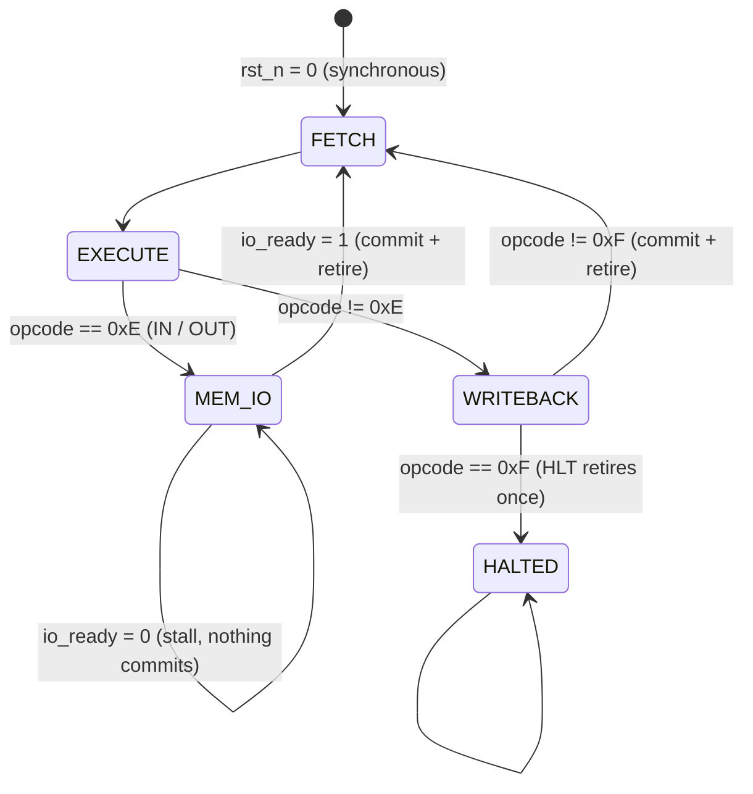

# M1 — Chosen microarchitecture and annotated block diagram

## Choice: multi-cycle FSM, 3 cycles per instruction (+ stall cycles for I/O)

Recommended by spec §4.3 and assumed by the §6.2 control table. One
instruction is in flight at a time, so instructions retire in program order
and `retire` pulses exactly once per instruction (R13, R22).

Key scheme (guide slide 10): **the PC holds the address of the executing
instruction for all of its cycles** and is advanced (`pc_en`) only in the
commit cycle. Because `instr_memory` reads combinationally, `imem_data` *is*
the instruction register and `pc` *is* `retire_pc` — no extra IR or PC copy is
needed, and the frozen `control_unit` port list (which has no IR-load output)
is respected.

## State machine



| State | Encoding | What happens | Enables asserted |
|---|---|---|---|
| FETCH | 3'd0 | PC drives `imem_addr`; instruction word settles (one full cycle — also leaves room for a registered BRAM read on the board) | none |
| EXECUTE | 3'd1 | decoder fields drive register-file reads; ALU, DMEM address and branch decision settle | none |
| WRITEBACK | 3'd2 | commit cycle for every non-I/O instruction | per table: `rf_we`, `mem_we`, `flags_we`, `pc_en`, `pc_load`, `retire` |
| MEM_IO | 3'd3 | `io_rd`/`io_wr` request held, `io_port`/`io_wdata` stable; waits for `io_ready` | request always; `rf_we`, `pc_en`, `retire` only when `io_ready = 1` (Mealy) |
| HALTED | 3'd4 | `halted = 1`; PC frozen on HLT's address | none, ever (R8, R9) |

CPI: 3 for every instruction except IN/OUT, which take 3 + *n* cycles where
*n* is the number of cycles the peripheral holds `io_ready` low.

## Annotated block diagram (inside `dsd8_cpu`)

```
                   +--------------------- addr9 (JMP/Bcc target) -------------------+
                   |                                                                 |
   pc_en,pc_load   v                                                                 |
  ---------->[ prog_counter ]--pc[8:0]--> imem_addr ==> instr_memory (outside core)  |
                   |                                         |                       |
                   +--> retire_pc            imem_data[15:0] | --> retire_ir          |
                                                             v                       |
                                                    [ instr_decoder ]--addr9---------+
                                         opcode,cond | rd  rs1  rs2  imm8  port io_dir
                     +-------------------------------+  |    |    |     |     |     |
                     v                                  |    |    |     |     +--> io_port
             [ control_unit FSM ]<--flags--+            |    v    v     |           |
    pc_en pc_load rf_we mem_we flags_we    |      ra2 = (op==ST||op==IN/OUT) ? rd : rs2   (glue 2)
    io_rd io_wr wb_sel halted retire       |            |  ra1=rs1 |    |           |
                                           |            v          v    |           |
                                           |     [ register_file 8x8 ]  |   io_dir qualifies
                                           |       rd1 |        | rd2   |   io_rd/io_wr/rf_we (glue 3)
                                           |           v        v       |
                                           |        a [  alu  ] b ------+--> io_wdata, dmem wdata
                                           |            | result, {z,n,c,v}
                                           +--[flags_reg]<-- flags_we   |
                                                        |               |
                 rd1 --> [ data_memory 256x8 ] rdata    |               |
                                     |                  |               |
                    wd = wb_sel: 0 ALU | 1 DMEM | 2 imm8 | 3 io_rdata  (glue 1)  --> register_file.wd
                    retire_* = commit-cycle values, zero-forced, flags bypass (glue 4)
```

## The four pieces of glue logic in `dsd8_cpu` (integration decisions)

1. **Write-back mux** — `wd = {alu_result, dmem_rdata, imm8, io_rdata}[wb_sel]`.
2. **Read-port-2 select** — `ra2 = (opcode == ST || opcode == IN/OUT) ? rd : rs2` (R18).
3. **IN/OUT qualification** — `control_unit` cannot see `io_dir`, so for opcode
   0xE it requests both directions and `dsd8_cpu` keeps only one:
   `io_rd = cu_io_rd & ~io_dir`, `io_wr = cu_io_wr & io_dir`,
   `rf_we = cu_rf_we & ~(opcode == 0xE & io_dir)`.
4. **Retire shaping (Scheme A, guide slide 35)** — retire in the commit cycle;
   `retire_rf_addr/data` and `retire_mem_addr/data` are forced to zero when the
   matching enable is low (R23); `retire_flags = flags_we ? alu_flags : flags_out`
   so field 10 shows the flags *after* the instruction.

## Data memory "cleared by reset" (R6, R16)

`data_memory` has no `rst_n`. Chosen: initialise the array to zero in an
`initial` block (simulators and FPGA block/distributed RAM honour it). The
rejected alternative (FSM writes 256 zeros after reset) would need an address
path the frozen ports do not provide without extra glue, and adds 256 cycles
to every test. Limitation recorded: a *second* reset during a run does not
re-clear DMEM — acceptable because every test and the board demo reset once.
